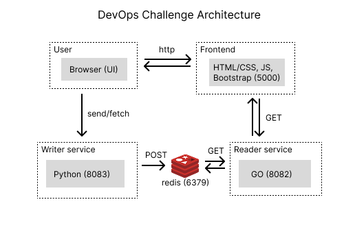

# DevOps Challenge
My solution for a technical challange made for upcoming Jr DevOps/SRE Engineers at the green bank💚

## How to Run
```bash
docker compose build
docker compose up --build
```
> The web page will be hosted at [https://localhost:5000/](https://localhost:5000/)


<br><br><br><br><br>


## Test on terminal
### Test the API health
```bash
curl.exe http://localhost:8082/health
```
> Should return **`up`**
### Writer
```bash
Invoke-WebRequest -Method POST -Uri http://localhost:8083/write -Body "hello"
```
### Reader
```bash
Invoke-WebRequest http://localhost:8082/data
```


<br><br><br><br><br>


# Architecture
### Stack
- Frontend: HTML/CSS, Bootstrap, JavaScript, Node.JS
- Backend: Python, GO
- Database: Redis

### Containers
The `docker-compose.yaml` will create & orchestrate 4 containers:
- `devops-challenge-web-1` - Web Service
- `devops-challenge-writer-1` - Writer Service
- `devops-challenge-reader-1` - Reader Service
- `devops-challenge-redis-1` - Redis Database

### Service Ports
- Web/Front: [http://localhost:5000/](http://localhost:5000)
- Reader: [http://localhost:8082/](http://localhost:8082)
- Writer: [http://localhost:8083/](http://localhost:8083)
- Redis: [http://localhost:6379/](http://localhost:6379)

### Flow
The user (using the `Web Service (Node.JS)`) can send or request data from the redis
- Send: `Writer Service (python)` writes on `Redis` and returns a code `201` to `Web Service (Node.JS)`
- Request: `Reader Service (GO)` reads from `Redis` and returns its data to `Web Service (Node.JS)`

<br>

### Architecture Design / Infra

